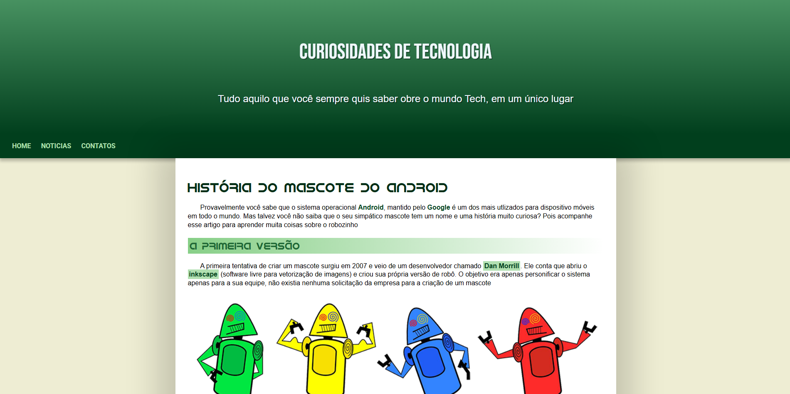

# Projeto Android (frontend estático)

Pequena página estática de exemplo criada no curso de HTLM e CSS do CursoemVideo que conta um pouco sobre a história do mascote do Android.

## Tecnologias

- HTML
- CSS

## Deploy

- GitHub Pages

Clique [aqui](https://leopinheirosilva.github.io/projeto-android/) para acessar o site!

## Contato

Email: <leonardopinheirosilva16@gmail.com>

LinkedIn: <https://www.linkedin.com/in/leonardo-pinheiro-13ba26281/>
